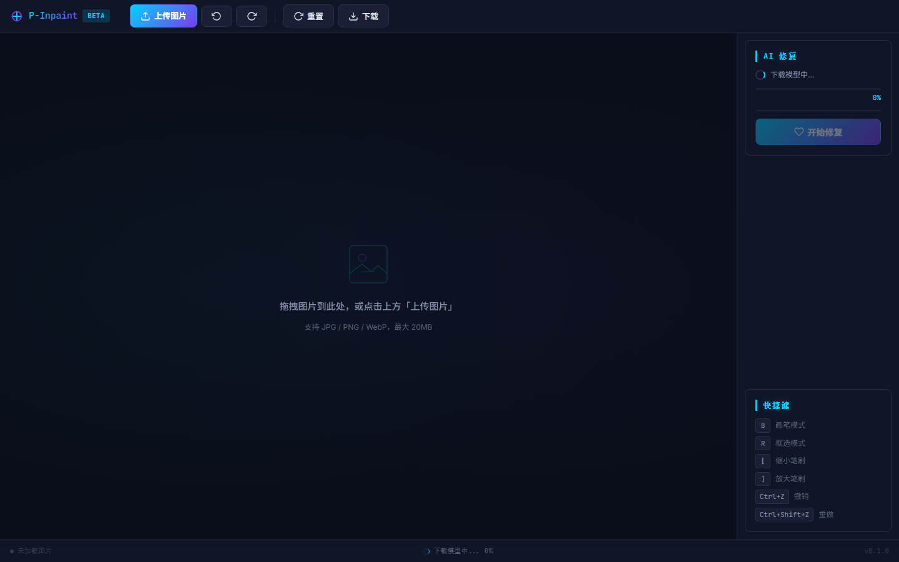

# P-Inpaint

P-Inpaint 是一个运行在浏览器中的 AI 图像修复工具。你可以用画笔或矩形框选需要处理的区域，再借助 MI-GAN 模型移除水印、修补瑕疵。图片不会上传到服务器，AI 推理在本地浏览器中完成。

> 当前状态：Beta。模型首次使用时需要联网下载，之后会缓存到浏览器 IndexedDB。



## 功能

- 画笔涂抹和矩形框选两种遮罩方式
- 浏览器内 AI 图像修复
- 撤销、重做、重置和结果下载
- 模型下载进度与缓存
- 拖拽上传图片
- 快捷键操作，适配桌面浏览器

## 快速开始

### 环境要求

- Node.js 20 或更高版本（建议使用当前 LTS 版本）
- npm
- 支持 WebAssembly 的现代桌面浏览器

### 本地运行

在项目根目录打开 PowerShell：

```powershell
npm install
npm run dev
```

浏览器访问 `http://localhost:3000`。页面启动后会下载 AI 模型，首次使用所需时间取决于网络状况。

Windows 用户也可以双击 `start.bat` 完成依赖安装和启动。

### 生产构建

```powershell
npm run build
npm run preview
```

构建结果位于 `dist/`，可部署到任意静态网站托管服务。

## 使用方法

1. 点击“上传图片”或将图片拖入画布区域。
2. 使用画笔涂抹，或切换到框选模式拖出矩形区域。
3. 点击“开始修复”，等待本地推理完成。
4. 检查结果后下载 PNG 图片，或点击“重置”恢复原图。

建议单张图片不超过约 400 万像素（例如 `2000 × 2000`）。超过该限制时应用会拒绝执行推理，以免浏览器内存不足。

## 快捷键

| 快捷键 | 操作 |
| --- | --- |
| `B` | 画笔模式 |
| `R` | 框选模式 |
| `[` / `]` | 缩小 / 放大画笔 |
| `Ctrl+Z` | 撤销 |
| `Ctrl+Shift+Z` | 重做 |

## 技术栈

| 模块 | 实现 |
| --- | --- |
| 界面 | Vue 3、Vite |
| 画布与遮罩 | Canvas 2D |
| AI 推理 | ONNX Runtime Web / WebAssembly |
| 修复模型 | MI-GAN ONNX |
| 模型缓存 | IndexedDB |

推理流程为：原图与遮罩转为张量，在浏览器内运行 ONNX 模型，再将输出像素写回 Canvas。

## 项目结构

```text
.
├─ src/
│  ├─ components/     # 顶栏、画布、工具面板和状态栏
│  ├─ composables/    # 画布、历史记录和 AI 推理
│  └─ styles/         # 全局主题样式
├─ scripts/           # 模型下载辅助脚本
├─ public/            # 静态资源
├─ index.html
├─ package.json
└─ vite.config.js
```

## 可用命令

| 命令 | 用途 |
| --- | --- |
| `npm run dev` | 启动开发服务器 |
| `npm run build` | 生成生产构建 |
| `npm run preview` | 本地预览生产构建 |

## 模型、网络与隐私

图片本身只在当前浏览器中处理，不会被应用上传。以下操作仍会产生网络请求：

- 首次使用时从 Hugging Face 下载 MI-GAN 模型，下载完成后缓存到 IndexedDB。
- ONNX Runtime 的 WebAssembly 文件默认从 jsDelivr CDN 加载。
- 页面字体从 Google Fonts 加载。

如果部署在离线环境中，需要自行托管模型、WASM 运行时和字体，并修改对应资源地址。

模型文件体积较大，因此不纳入 Git 仓库。清除浏览器站点数据后，需要重新下载模型。

## 已知限制

- 当前仅验证桌面端交互，移动端触控操作尚未完整适配。
- 修复效果依赖遮罩准确度和原图内容，复杂纹理、文字或大面积缺失区域可能出现模糊。
- 首次加载依赖网络；模型或 CDN 不可用时会显示错误。
- 推理速度取决于设备性能和浏览器 WebAssembly 支持情况。
- 当前仓库尚未配置自动化测试，修改后至少需要执行构建和手动回归。

## 参与开发

提交改动前请先阅读 [AGENTS.md](./AGENTS.md)，并至少运行：

```powershell
npm run build
```

请不要提交 `node_modules/`、`dist/`、ONNX 模型、密钥或用户图片。

## 参考资料

- [inpaint-web](https://github.com/lxfater/inpaint-web)：项目实现思路参考
- [MI-GAN](https://github.com/Picsart-AI-Research/MI-GAN)：修复模型研究项目
- [ONNX Runtime Web](https://onnxruntime.ai/docs/tutorials/web/)：浏览器推理运行时

## 使用声明

请仅处理你有权修改的图片。移除水印可能涉及著作权、肖像权或平台服务条款，使用者应自行确认使用场景合法合规。

## 许可证

当前仓库尚未声明开源许可证。在补充 `LICENSE` 文件前，默认不授予复制、修改或分发许可。
